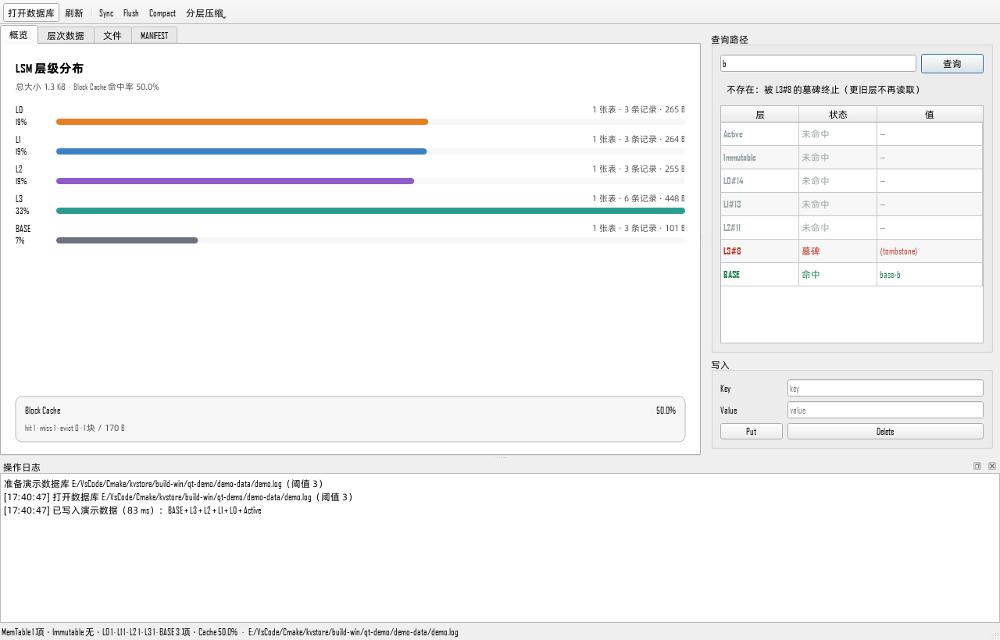

# KVStore：从零实现的 LSM-Tree 单机存储引擎


一个 C++17 编写的嵌入式持久化键值存储，实现了 WAL、有序 MemTable、不可变
MemTable、后台 Flush、L0–L3 SSTable、MANIFEST 版本提交、MVCC 快照与
L0→L1→L2→L3 部分分层压缩。配套一个 Qt Widgets 可视化控制台，用来观察层级
分布、Block Cache、MANIFEST 和单 key 的查询路径。



## 核心特性

- **写入路径**：`Put/Delete` 追加 WAL → 更新有序 MemTable → 达到阈值后冻结。
- **崩溃恢复**：WAL 重放、截断尾部修复、CRC 校验；Active/Immutable 双 WAL 轮换
  保证冻结快照在发布为 SSTable 之前始终可恢复。
- **后台 Flush**：单后台线程把冻结快照写成 SSTable，提交 MANIFEST 后再回收
  Immutable WAL；前台通过条件变量等待发布完成（Flush 屏障）。
- **版本提交**：MANIFEST 是完整文本快照，带 CRC32；`tmp → fsync → rename →
  目录 fsync` 一次原子替换即切换版本。
- **全量 Compact**：合并 BASE、所有 L0 和 Active 数据，生成新 BASE 并一次性
  退役全部 L0；旧文件残留不会让删除的 key 复活。
- **并发安全**：单互斥锁保护全部状态，后台线程只处理冻结快照；进程锁防止
  同一个数据库被多个进程打开。
- **可观测性**：`inspect_entries` / `explain_key` / `inspect_tables` 只读接口，
  Qt 控制台直接展示层次数据和查询路径（含被遮蔽的旧值）。
- **MVCC 快照读**：内部键为 `转义后的 user_key + 0x00 0x00 + 反序 sequence(8B) + type(1B)`；
  `snapshot()` / `get(key, snapshot)` / `new_iterator(snapshot)` 可读取历史版本，
  墓碑在快照中同样可见。Compact 按最老活跃快照回收旧版本：保留快照可见的版本，
  无快照时每个 key 只保留最新版本。
- **WriteBatch**：多条 Put/Delete 合并成一条 WAL Batch 记录，共享一个 commit
  sequence 原子提交；恢复时整条记录重放，截断则整批回滚。
- **部分分层压缩**：L0→L1 默认 L0 表数 ≥ 4 自动触发；L1→L2 默认 16 MiB；
  L2→L3 默认 32 MiB。每层只重建与上层 key range 重叠的表，L1/L2/L3 均按
  约 4 MiB 拆成 key-range 不重叠的表，BASE 不动。
- **SSTable v2 footer**：记录级索引、Bloom、user-key range 持久化到文件尾部；
  打开时只读 footer，不再扫描全部记录；旧 v1 表仍可扫描打开。
- **块式 SSTable + Bloom + Block Cache**：L0 按约 4 KiB 分块，Bloom 从 footer
  加载；读路径先 Bloom 过滤，再按块加载，LRU Block Cache 默认 8 MiB。
- **快照迭代器**：`new_iterator()` 跨所有层做多路归并，
  提供 `Seek/Next` 并跳过墓碑；物化一份有序快照，适合小数据量和调试。
- **流式 MergingIterator**：`new_streaming_iterator()` 每层一个游标，按内部键归并，
  value 按需从 SSTable/BASE 读取；`scan(begin, end, limit)` 提供范围扫描
  （begin 包含，end 不包含），不复制整库数据。
- **跨平台**：核心逻辑 POSIX/Windows 双实现（`src/platform.cpp`），
  Windows 上用 `CreateFile/FlushFileBuffers/MoveFileEx` 替代 `fsync/rename/flock`。

### MVCC / WriteBatch 用法

```cpp
auto snapshot = store.snapshot();
store.get("key", snapshot);          // read at a stable sequence
auto iterator = store.new_iterator(snapshot);

auto streaming = store.new_streaming_iterator(snapshot);
auto rows = store.scan("a", "z", 100, snapshot);  // [a, z)
store.set_level0_compaction_trigger(4);           // 0 disables auto L0->L1
store.compact_levels();                          // explicit L0 -> L1
store.set_level1_to_level2_trigger_bytes(16 * 1024 * 1024);
store.compact_l1_to_l2();                        // explicit L1 -> L2
store.set_level2_to_level3_trigger_bytes(32 * 1024 * 1024);
store.compact_l2_to_l3();                        // explicit L2 -> L3

KVStore::WriteBatch batch;
batch.put("a", "1");
batch.erase("b");
store.write(batch);                  // one WAL record, all-or-nothing
```

## 架构

```text
写：Put/Delete
      → 追加 WAL 记录（不 fsync）
      → 更新 Active MemTable（std::map，有序，nullopt 为墓碑）
      → 不同 key 数 ≥ 阈值（默认 64）
      → 冻结：fsync WAL → 改名 .imm → 新建 Active WAL → 快照 swap
      → 后台线程：写 L0 SSTable → 提交 MANIFEST → 删除 .imm

读：Active MemTable
      → Immutable MemTable
      → L0 从新到旧
      → L1（Bloom 过滤 + 块读取）
      → L2（Bloom 过滤 + 块读取）
      → L3（Bloom 过滤 + 块读取）
      → BASE 内存索引 + 磁盘读值

Compact：冻结并等待后台 → 合并 BASE + 全部 L0 + L1 + L2 + L3 + Active
      → 写新 BASE（tmp → fsync → rename）
      → 一次 MANIFEST 提交（BASE/RETIRED 前进、L0/L1/L2/L3 清空）
      → 回收旧文件、重置 WAL

L0→L1：只选与 L0 key range 重叠的 L1 表，和全部 L0 合并
      → 按 4 MiB 拆成新 L1；未重叠 L1 保留；BASE 不动

L1→L2：只选与 L1 key range 重叠的 L2 表，和全部 L1 合并
      → 按 4 MiB 拆成新 L2；未重叠 L2 保留；L1 清空

L2→L3：只选与 L2 key range 重叠的 L3 表，和全部 L2 合并
      → 按 4 MiB 拆成新 L3；未重叠 L3 保留；L2 清空
```

## 磁盘文件

| 文件 | 内容 |
| --- | --- |
| `kvstore.log.wal` | Active MemTable 的 WAL |
| `kvstore.log.wal.L0.<20位编号>.imm` | 已冻结、尚未发布的 WAL |
| `kvstore.log.L0.<20位编号>.sst` | L0 表，有效性由 MANIFEST 决定 |
| `kvstore.log.L1.<20位编号>.sst` | L1 表，key range 互不重叠 |
| `kvstore.log.L2.<20位编号>.sst` | L2 表，key range 互不重叠 |
| `kvstore.log.L3.<20位编号>.sst` | L3 表，key range 互不重叠 |
| `kvstore.log.manifest` | 完整版本快照（文本 + CRC32） |
| `kvstore.log.base.<20位编号>.log` | Compact 生成的基础数据 |
| `kvstore.log` | 旧格式基础文件（仅 `BASE 0` 时使用） |
| `kvstore.log.lock` | 进程锁 |

记录格式：8 字节文件头（`KVDB` + 版本号），随后每条记录为
`u8 op | u32 key_len | u32 value_len | key | value | u32 crc32`。

L0–L3 SSTable 使用 v2 格式：文件头 + 记录 + footer（记录索引、Bloom、
user-key range、CRC32）；打开时只读 footer，v1 表回退到全表扫描。

## 构建与测试（Linux / WSL）

```bash
cmake -S . -B build-ubuntu -DCMAKE_BUILD_TYPE=Debug
cmake --build build-ubuntu -j2
ctest --test-dir build-ubuntu --output-on-failure
```

当前 22 项测试全部通过，覆盖模型对拍、WAL 截断修复、L0 遮蔽顺序、后台 Flush、
并发与进程锁、MANIFEST 的六类中断点恢复、SIGKILL 循环恢复、MVCC 快照、
WriteBatch 原子提交、快照感知 GC、流式迭代器与范围扫描、块式 SSTable/Bloom/
Block Cache、SSTable v2 footer、L0→L1、L1→L2、L2→L3 部分压缩，以及可视化
控制台使用的只读观测接口。

```bash
# 单测示例
ctest --test-dir build-ubuntu -R '^kvstore_manifest_tests$' -V

# 命令行体验
./build-ubuntu/kvstore_cli
```

CLI 支持 `Put / Get / Delete / Sync / Flush / Compact / Exit`。

其中 `kvstore_crash_recovery_tests` 会 fork 子进程顺序写入、随机延迟后 `SIGKILL`，
重开校验“已写入的 key 必须构成前缀”。默认 100 次，可用
`KVSTORE_CRASH_ITERATIONS` 调整；本机实测 200 次全部通过（存活 key 150–1851，
无空洞、无错值）。

Sanitizer 构建：

```bash
cmake -S . -B build-asan -DCMAKE_BUILD_TYPE=Debug \
  -DKVSTORE_SANITIZER=address,undefined
cmake --build build-asan -j2
ctest --test-dir build-asan --output-on-failure
```

实测 ASan/UBSan 下 22/22 通过；TSan 逐项运行通过，整套串跑偶发 TSan
allocator 误报（WSL/glibc 环境），不作为代码 race 结论。
（不含依赖 fork 的 crash test），无数据竞争报告。

Windows 下引擎与 CLI 也可以构建（POSIX 调用由 `src/platform.cpp` 的 Win32
实现替代）：

```powershell
cmake -S . -B build-win -G Ninja -DCMAKE_BUILD_TYPE=Release `
  -DCMAKE_CXX_COMPILER=<MinGW>/bin/g++.exe
cmake --build build-win
```

## 性能基准

`bench/benchmark.cpp` 提供单线程基准，覆盖 Put/Get、value 大小、Flush/Compact 和 L0 读放大。

```bash
cmake -S . -B build-bench -DCMAKE_BUILD_TYPE=Release -DBUILD_TESTING=OFF
cmake --build build-bench -j2 --target kvstore_bench
./build-bench/kvstore_bench
```

默认使用 `std::filesystem::temp_directory_path()`；Linux 下建议用 `TMPDIR` 指向真实文件系统，
避免 tmpfs 让 `fsync` 变成空操作：

```bash
mkdir -p /home/you/kvstore-bench
TMPDIR=/home/you/kvstore-bench ./build-bench/kvstore_bench
```

本机实测（WSL2 / Ubuntu 26.04 / ext4 / i9-13980HX / 单线程，value 100 B，5 万 key）：

| 指标 | 数值 |
| --- | --- |
| Put 吞吐（不含 fsync） | 23.8 万 ops/s |
| 一次 sync | 8.6 ms |
| Get（MemTable） | 116 万 ops/s，P50 0.6 us / P99 1.4 us |
| Get（L0，预热后） | 63.5 万 ops/s，P50 1.3 us / P99 2.8 us |
| Flush | 173.7 ms |
| Compact | 197.0 ms |
| Get（BASE） | 26.5 万 ops/s，P50 3.3 us / P99 7.7 us |
| Block Cache 命中 / 未命中 / 驱逐 | 58333 / 1667 / 0 |

value 大小对吞吐的影响：

| value | 记录数 | Put ops/s | Get ops/s | Get P99 |
| --- | --- | --- | --- | --- |
| 64 B | 20000 | 26.7 万 | 138 万 | 1.2 us |
| 1 KiB | 20000 | 9.46 万 | 100 万 | 1.7 us |
| 4 KiB | 10000 | 3.11 万 | 86.4 万 | 1.9 us |

L0 读放大（`missing` 需要扫完所有 L0；`victim` 命中最早的表）：

| L0 表数 | missing P50 | victim P50 |
| --- | --- | --- |
| 1 | 0.08 us | 0.32 us |
| 10 | 0.19 us | 0.35 us |
| 25 | 0.26 us | 0.45 us |
| 50 | 0.40 us | 0.62 us |

说明：

- Put 只写 WAL 到页缓存，不含 `fsync`；`sync` 是 5 万条写后的一次 fsync。
- 每个 key 额外带 11 B 的 MVCC 内部后缀，所以 BASE 约 6738 KiB；5 万个 key 都是唯一的，
  没有旧版本可回收，因此 Compact 前后大小不变；覆盖/删除场景由 `kvstore_compaction_tests` 覆盖。
- L0 表数到 50 时 `missing` P50 仍只有 0.40 us：Bloom 先过滤不存在的 user key，
  Block Cache 复用已解析的数据块；优化前同一基准为 12.46 us（约 31 倍）。
- L0 Get 是预热后的稳态；首次访问会有冷缓存 miss，P99 会更高。
- Put/Get 已包含内部键编码、Bloom 过滤、块加载与快照版本选择；数字是本机实测，
  换机器会变。

## Qt 可视化控制台

`qt-demo/` 是一个 Qt Widgets 程序，链接 `libkvstore.a`，全部引擎调用都在 worker
线程执行，界面通过队列信号刷新。功能：

- 层次数据表：Active / Immutable / L0（新→旧）/ BASE，墓碑标红；
- 查询路径：逐层展示命中/墓碑/未命中，并给出最终结果；
- 文件列表：WAL、`.imm`、`.sst`、`.base.*.log`、MANIFEST 及大小；
- MANIFEST 原文、操作日志、Sync / Flush / Compact 按钮。

构建（Windows + MSYS2 Qt6，或 Linux 安装 `qt6-base-dev`）：

```powershell
# Windows：Qt 装在项目内的 .toolchains/msys64 时，直接运行脚本
.\scripts\build-qt-demo.ps1
.\scripts\run-qt-demo.ps1 -Demo
```

```bash
# Linux / WSL
cmake -S . -B build-qt -G Ninja -DKVSTORE_BUILD_QT_DEMO=ON \
  -DCMAKE_PREFIX_PATH=<Qt6 安装路径>
cmake --build build-qt
./build-qt/qt-demo/kvstore_qt_demo --demo
```

`--demo` 会生成一个包含 BASE + L0 + Active 三层的演示库；在查询框输入 `b`
可以看到 L0 的墓碑遮蔽 BASE 中的旧值。`--screenshot <path>` 可无头导出截图。
详见 [qt-demo/README.md](qt-demo/README.md)。

## 设计取舍

| 决策 | 原因 | 代价 |
| --- | --- | --- |
| 每 key 全量内存索引 + 块索引 | 块读取/Bloom 降低读放大，实现比 B+ 树简单 | 大库索引仍占内存 |
| LRU Block Cache（8 MiB） | 热点块复用，避免重复解析 | 额外内存；冷启动有 miss |
| L1/L2/L3 按 4 MiB 拆分 + 部分压缩 | 控制单表大小，只重写重叠表 | 需要维护每表 key range |
| SSTable v2 footer | 打开只读 footer，不扫全表 | footer 损坏需拒绝/回退 |
| 全量文本 MANIFEST | 一次替换提交整个版本，易校验 | 每次 Flush 重写整份清单 |
| 单后台线程 + 单 Immutable 槽位 | 天然背压，状态简单 | 前台写入可能被阻塞 |
| Compact 持锁 | 实现简单、版本一致 | 压缩期间阻塞读写 |
| 记录级 CRC + footer CRC | 能定位损坏记录和元数据 | 仍无整文件校验和 |

## 目录结构

```text
kv_store.h / src/       引擎实现（WAL、MemTable、SSTable、MANIFEST、平台层）
app/main.cpp            命令行程序
bench/                  单线程性能基准
qt-demo/                Qt Widgets 可视化控制台
tests/                  22 个端到端测试
learning/               学习期练习代码
docs/                   截图与文档
```

## Roadmap

- [x] 单线程性能基准（Put/Get、value 大小、L0 读放大、Compact）
- [x] SIGKILL 崩溃恢复循环（200 次）
- [x] ASan/UBSan/TSan 验证
- [ ] 磁盘满 / EIO 故障注入
- [x] L0 → L1 分层压缩（默认 L0≥4 自动触发，L1 按 4 MiB 拆分）
- [x] L1 → L2 部分分层压缩（默认 L1≥16 MiB 自动触发）
- [x] L2 → L3 部分分层压缩（默认 L2≥32 MiB 自动触发）
- [x] SSTable v2 footer（索引 / Bloom / key range，兼容 v1 扫描）
- [x] SSTable 块索引 + Bloom Filter
- [x] LRU Block Cache（默认 8 MiB）
- [x] 快照迭代器（Seek/Next，跳过墓碑）
- [x] MVCC 快照读（get / iterator）
- [x] WriteBatch 原子提交
- [x] 快照感知 GC（按最老活跃快照回收旧版本）
- [x] 流式 MergingIterator / 范围扫描 API
- [ ] WAL 组提交、无锁读路径

## License

MIT
