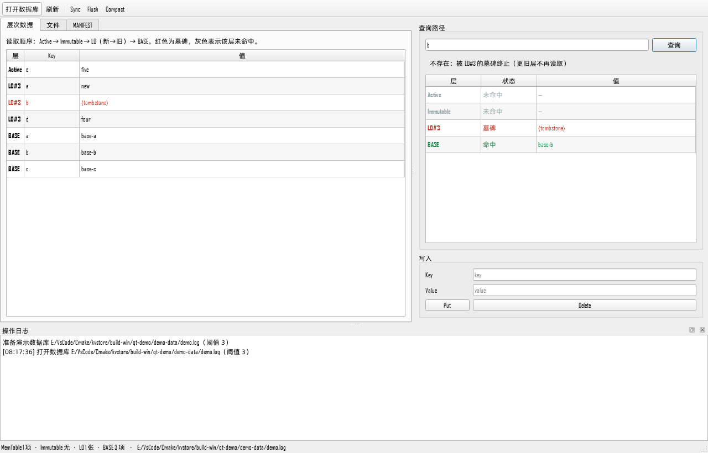

# Qt 控制台（kvstore_qt_demo）

一个只读优先的 LSM 可视化控制台，用来观察引擎各层数据、MANIFEST 和单 key 的查询路径。



## 界面说明

- **层次数据**：按 `Active → Immutable → L0（新→旧）→ BASE` 顺序展示所有条目；
  墓碑标红，空值显示为 `⟨空字符串⟩`。
- **查询路径**：对输入的 key 逐层探测，显示每层是“命中 / 墓碑 / 未命中”，
  并给出最终结果。被遮蔽的旧值也会显示，方便理解 tombstone 的终止语义。
- **文件**：WAL、`.imm`、`.sst`、`.base.*.log`、MANIFEST 及大小。
- **MANIFEST**：清单原文。
- **写入 / 操作**：Put、Delete、Sync、Flush、Compact，全部在 worker 线程执行。

## 线程模型

`EngineWorker` 持有 `KVStore` 并被 `moveToThread` 到后台线程；主窗口只通过
队列信号收发 `DemoSnapshot`。UI 线程永远不会执行 `fsync`、等待后台 Flush 或
Compact 这类阻塞调用。

## 构建

### Windows（MSYS2 Qt6 + MinGW）

仓库不在 Git 中携带 Qt SDK。把 Qt 装到项目目录（例如 `.toolchains/msys64`）后：

```powershell
# 需要 MSYS2 的 mingw64 环境里安装：
#   pacman -S mingw-w64-x86_64-gcc mingw-w64-x86_64-qt6-base \
#            mingw-w64-x86_64-cmake mingw-w64-x86_64-ninja
.\scripts\build-qt-demo.ps1
.\scripts\run-qt-demo.ps1 -Demo
```

没有这套工具链时，用 Qt 官方安装器装 Qt 6.8 LTS（MSVC 或 MinGW），然后：

```powershell
cmake -S . -B build-qt -G Ninja `
  -DKVSTORE_BUILD_QT_DEMO=ON `
  -DCMAKE_PREFIX_PATH=C:/Qt/6.8.3/msvc2022_64
cmake --build build-qt
```

### Linux / WSL

```bash
sudo apt install qt6-base-dev
cmake -S . -B build-qt -DKVSTORE_BUILD_QT_DEMO=ON
cmake --build build-qt
./build-qt/qt-demo/kvstore_qt_demo --demo
```

## 演示模式

```bash
./kvstore_qt_demo --demo
```

首次打开会在可执行文件旁的 `demo-data/demo.log` 生成一个演示库：

- BASE：`a=base-a`、`b=base-b`、`c=base-c`
- L0：`a=new`、`b=墓碑`、`d=four`
- Active：`e=five`

在“查询路径”输入 `b`，可以看到 L0 的墓碑终止查询，而 BASE 里仍有 `b=base-b`；
输入 `a` 可以看到 L0 的 `new` 遮蔽 BASE 的 `base-a`。

## 无头截图

```powershell
.\scripts\run-qt-demo.ps1 -Demo -Screenshot docs\screenshot.png
```

使用 Qt 的 offscreen 平台插件渲染，适合在 CI 或没有显示器的环境生成 README 图片。

## 打包成可分发目录

`build-win/qt-demo/dist/` 已经包含 exe、Qt DLL、平台插件和 MinGW 运行库，复制到
没装 Qt 的 Windows 机器也能直接运行。重新打包：

```powershell
$msys = ".toolchains\msys64\mingw64"
$dist = "build-win\qt-demo\dist"
cmake --build build-win
New-Item -ItemType Directory -Force $dist
Copy-Item build-win\qt-demo\kvstore_qt_demo.exe $dist
& "$msys\bin\windeployqt.exe" --release --no-translations --compiler-runtime "$dist\kvstore_qt_demo.exe"
Copy-Item "$msys\share\qt6\plugins\platforms\qoffscreen.dll" "$dist\platforms\"
```

注意：`windeployqt` 不会复制 MSYS2 的 MinGW 运行库（`libstdc++-6.dll`、
`libgcc_s_seh-1.dll`、`libwinpthread-1.dll`）以及 ICU/FreeType 等依赖，需要从
`$msys\bin` 手动补齐；`dist` 只用于本地演示，不要提交到 Git。
